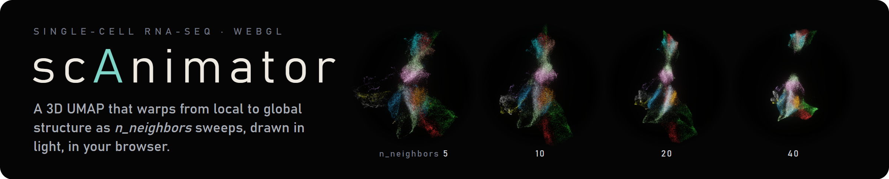
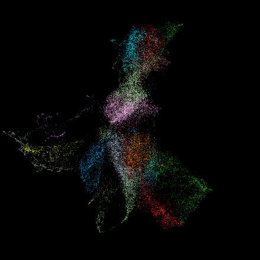
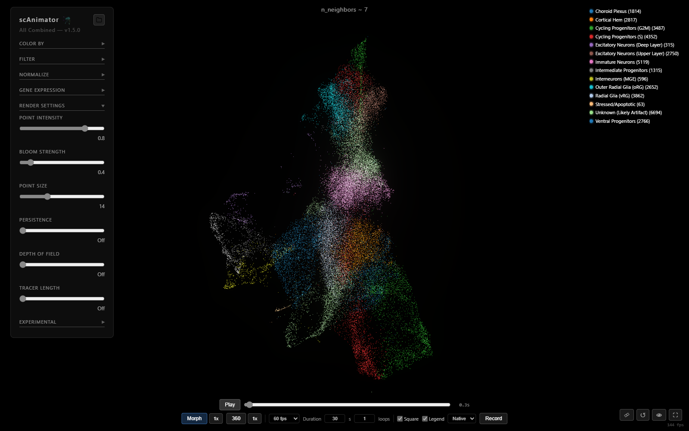
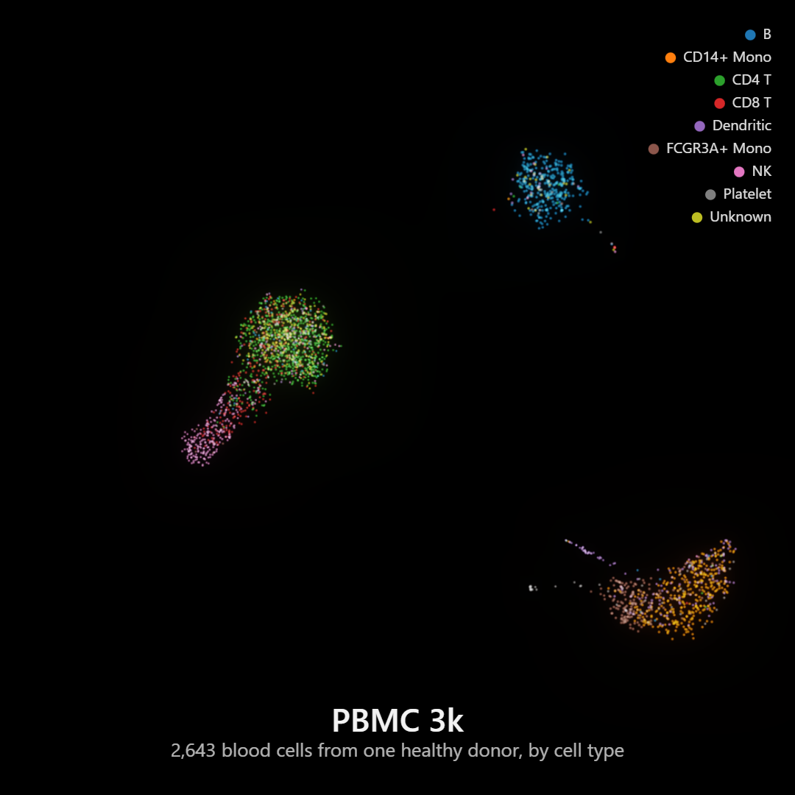
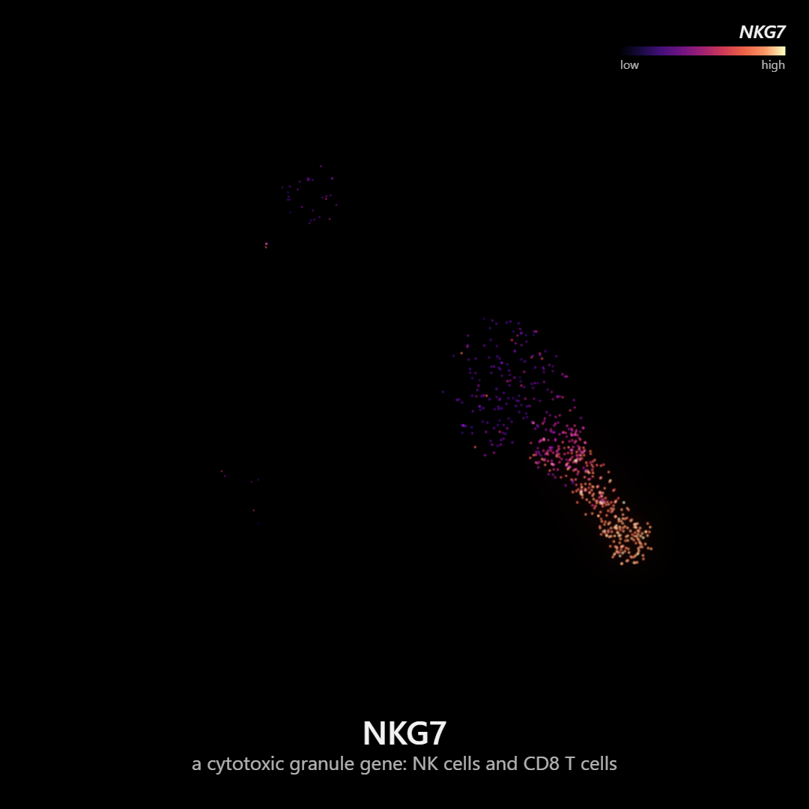
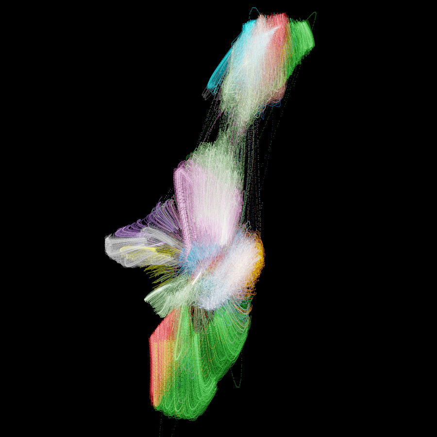
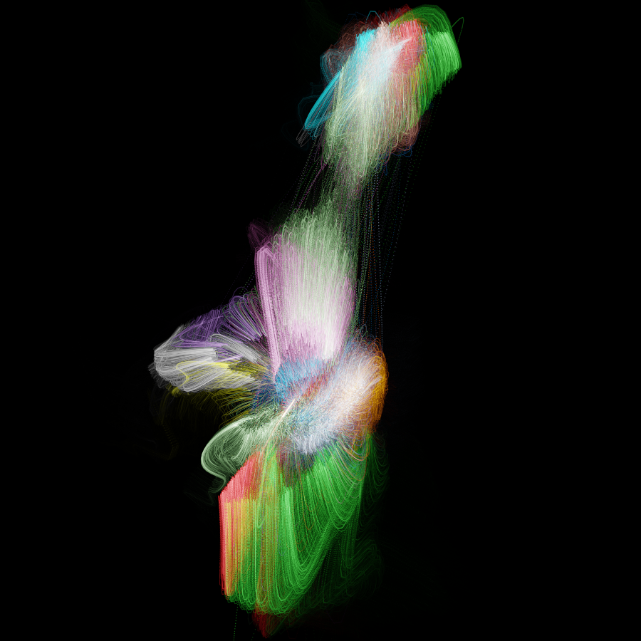
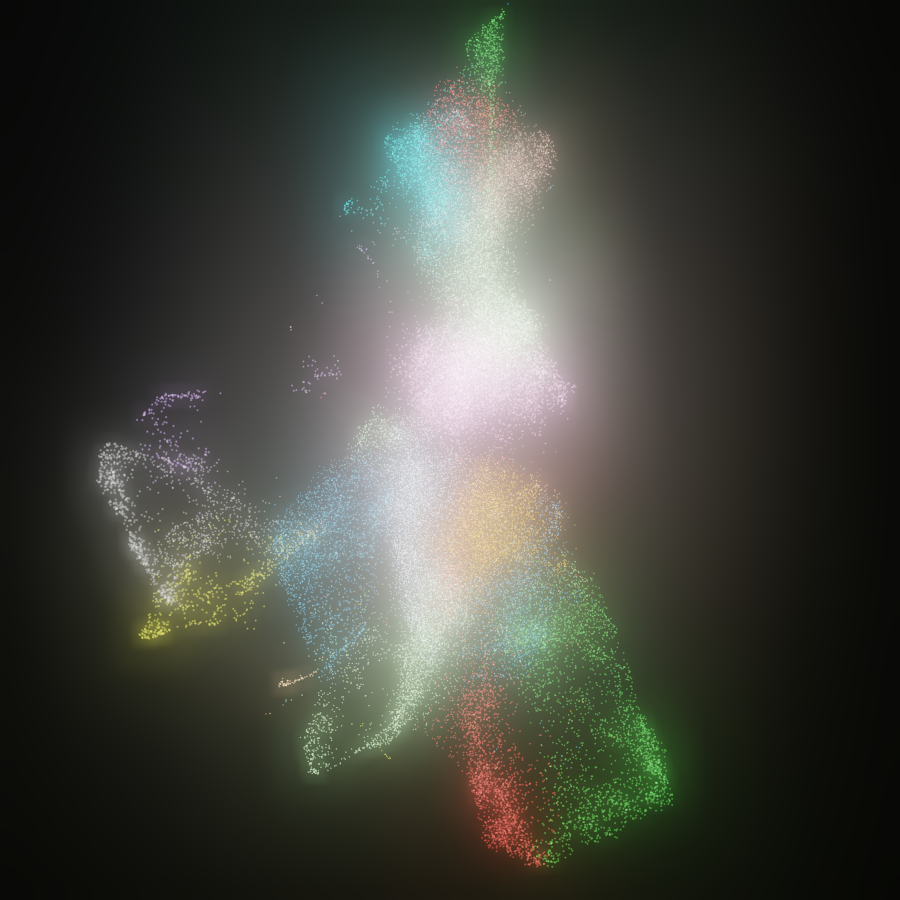
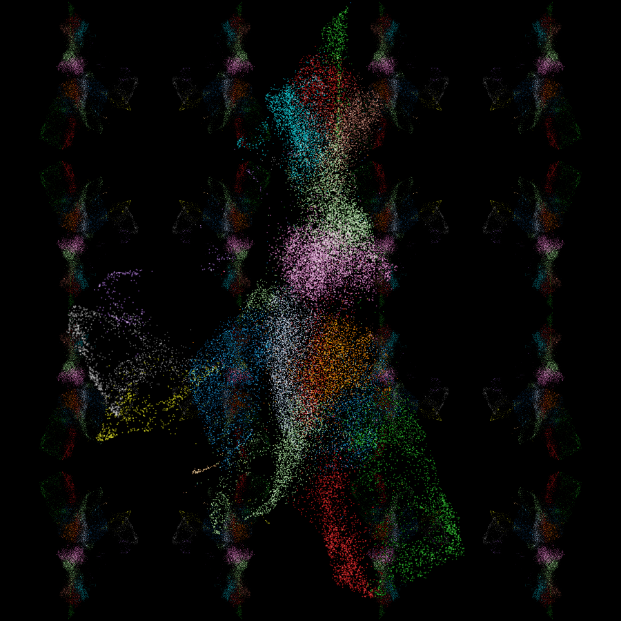

<p align="center">
  <a href="https://gsnautilus.github.io/scAnimator/"></a>
</p>

<p align="center">
  
</p>

<h1 align="center">scAnimator</h1>

<p align="center">
  <b>Interactive 3D UMAP warp viewer for single-cell RNA-seq</b><br>
  WebGL in the browser &middot; gene overlays &middot; frame-exact video export &middot; scripted, captioned storyboards
</p>

<p align="center">
  <a href="https://gsnautilus.github.io/scAnimator/"><b>&#9654; Open the live demo</b></a> (PBMC 3k, nothing to install)<br>
  <a href="manual/scAnimator_Manual.pdf">User manual (PDF, 17 pages)</a> &middot;
  <a href="https://github.com/GSNautilus/scAnimator/releases/download/v1.5.0/scAnimator_tour.mp4">Video tour (MP4, 2 min)</a>
</p>

---

A UMAP plot is one answer to a question with a dial on it: `n_neighbors`, how local or global the
picture should be. scAnimator turns the dial. It computes 3D UMAPs across a sweep of `n_neighbors`
values, aligns them to each other and interpolates between them, so you can watch clusters merge,
split and drift as the embedding moves from local to global structure. Every cell is drawn as a small
light on black, so dense populations glow.

On top of the animation you can colour and filter cells by any metadata, overlay any gene, shape the
light with bloom, persistence, depth of field and tracers, record frame-exact video at up to 4K, and
script a captioned tour of your data that you present with a clicker or render to MP4. It runs on
anything from a 3,000-cell demo to atlases of a million cells, and your own data never leaves your
computer.

## What it does

- **The warp.** 3D UMAP keyframes across an `n_neighbors` sweep (e.g. 5 to 150), Procrustes-aligned and cubic-spline interpolated, played as a seamless loop; scrub it, slow it, or hold one frame.
- **Colour, filter, normalize.** Colour by any categorical column (cell type, cluster, sample&hellip;), a solid colour, or gradients that cycle in time. Filter cells by any column, toggle categories from the legend, and downsample groups to equal counts so big populations don't hide small ones.
- **Gene expression.** Type a gene (autocomplete ranked by expression) and show it as a colormap (7 maps), point size or brightness, on linear, log or quantile scales. Genes stream on demand by HTTP Range request, so even large datasets open fast.
- **Rendering.** Custom Three.js point shaders with additive blending, bloom, persistence trails, depth of field and per-cell tracers.
- **Camera and timeline.** Orbit and zoom, automatic 360° turns, one master timeline that loops morph and rotation together.
- **Recording.** Steps through the timeline frame by frame (not a screen capture): every frame exact at 24 to 120 fps, at native size, 2K or 4K, optionally square with the legend drawn in. Frames stream into a ZIP64 archive, so long 4K recordings don't run out of memory.
- **Storyboards.** A short JSON file of steps (colour, filter, gene, `n_neighbors`, caption, or a full-frame slide). Present it live with arrow keys or a clicker, with smooth transitions between steps, or render it to MP4 clips with `scripts/render_storyboard.py`.
- **Experimental.** Audio reactivity (bass, mids and highs from a microphone or loopback drive size, brightness, colour or displacement, per cluster if you like) and a fractal reflection mode, for projection and live visuals.
- **Your own data.** One script turns an AnnData `.h5ad` or a Seurat export into a dataset; open it from your own server or straight from disk with **Load Folder**.

## A look around

<p align="center"></p>
<p align="center"><i>The viewer on a ~39,000-cell neural dataset, with the Render Settings group open.</i></p>

| | | |
|:---:|:---:|:---:|
|  |  |  |
| Colour by cell type (a storyboard frame) | A gene as a colormap | Tracers while the camera turns |
|  |  |  |
| Persistence | Bloom | Fractal reflection |

Every one of these pictures was taken from the viewer itself by [`manual/capture.py`](manual/capture.py).
The [user manual](manual/scAnimator_Manual.pdf) walks through every control.

## How it works

```
Seurat (R) ── scripts/export_seurat.R ──┐
                                        ├──> scripts/build_viewer.py ──> datasets/<id>/ ──> viewer.html (WebGL)
AnnData (.h5ad, Python) ────────────────┘
```

1. **Keyframes.** `build_viewer.py` runs a 3D UMAP at each `n_neighbors` value of the sweep, all from the same PCA (or any `obsm` embedding).
2. **Alignment.** Each keyframe is Procrustes-aligned (rotation, reflection, scale) to the one before it, so only real structural change shows up as motion.
3. **Interpolation.** A cubic spline gives every cell a smooth path through the keyframes; playback runs up the sweep and back down, so it loops.
4. **Expression.** Each gene is quantized to 8 bits and stored back to back in one file with a byte index, so the viewer fetches exactly one gene at a time with an HTTP Range request.
5. **Rendering.** The viewer (`viewer.html`, one file, no build step) loads the frames as one binary buffer and draws them with Three.js: a custom `ShaderMaterial` with per-point colour and size, additive blending, `UnrealBloomPass`, render-target ping-pong for trails, a depth pass for depth of field.

Above 200,000 cells the build reads the `.h5ad` in backed mode and streams expression through `h5py`,
and a sweep keeps checkpoints so an interrupted run resumes.

## Bring your own data

From Python (AnnData):

```
pip install numpy pandas scipy scanpy umap-learn h5py
python scripts/build_viewer.py --input my_data.h5ad --output-dir datasets/my_data --name "My data" --sweep 5-150-11
python scripts/update_dataset_index.py
```

From R (Seurat v4 or v5):

```r
source("scripts/export_seurat.R")
export_for_scanimator(obj, "export", cell_type = "cell_type", columns = c("seurat_clusters", "orig.ident"))
```

```
python scripts/build_viewer.py --export-dir export --output-dir datasets/my_data --name "My data" --sweep 5-150-11 --metadata-cols cell_type,seurat_clusters,orig.ident
python scripts/update_dataset_index.py
```

Then serve the folder and open it:

```
python -m http.server 8000
```

Open <http://localhost:8000>. Or skip the server: on the [live demo](https://gsnautilus.github.io/scAnimator/)'s
landing page, **Load Folder** opens a built dataset straight from disk. The files are copied into your
browser's own storage and are never uploaded. `python scripts/build_viewer.py --help` lists every option;
the manual explains them.

## Storyboards

```json
{
  "dataset": "pbmc3k",
  "render": { "point_size": 40, "brightness": 0.8, "bloom": 0.5 },
  "steps": [
    { "name": "overview", "color_by": "cell_type", "n_neighbors": 5, "caption": "PBMC 3k" },
    { "name": "lymphocytes", "filter": { "cell_type": ["CD4 T", "CD8 T", "NK", "B"] }, "caption": "Lymphocytes" },
    { "name": "nkg7", "color_by": "gene:NKG7", "colormap": "magma", "caption": "NKG7" }
  ]
}
```

Drop the file on the viewer (or use the film-strip button) and step through it with the arrow keys; or
render it:

```
pip install playwright imageio-ffmpeg
python scripts/render_storyboard.py examples/pbmc3k_tour.json
```

A full example with a slide is in [`examples/pbmc3k_tour.json`](examples/pbmc3k_tour.json).

## Repository

```
index.html                    landing page: dataset cards, Load Folder
viewer.html                   the viewer (single file, Three.js from a CDN)
datasets/pbmc3k/              the public demo dataset
scripts/build_viewer.py       .h5ad or Seurat export -> dataset files
scripts/export_seurat.R       Seurat -> export for build_viewer.py
scripts/update_dataset_index.py
scripts/render_storyboard.py  storyboard -> MP4 clips
examples/pbmc3k_tour.json     an example storyboard
manual/                       the user manual: scanimator.html + style.css, capture.py (pictures), build.py (PDF)
```

## Demo data credit

The live demo uses the **3k PBMCs from a Healthy Donor** dataset from
[10x Genomics](https://www.10xgenomics.com/datasets/3-k-pbm-cs-from-a-healthy-donor-1-standard-1-1-0),
licensed under [CC BY 4.0](https://creativecommons.org/licenses/by/4.0/). It was downloaded with
`scanpy.datasets.pbmc3k()` and modified: QC-filtered, normalized, annotated with canonical marker
genes, embedded with UMAP and quantized into the files in `datasets/pbmc3k/`. 10x Genomics does not
endorse this project.

The larger dataset in some pictures is a ~39,000-cell neural dataset; only pictures of it are
published here, not the data.

## License

The code is under the [MIT License](LICENSE). The PBMC 3k demo data in `datasets/pbmc3k/` stays under
CC BY 4.0 (see above).
